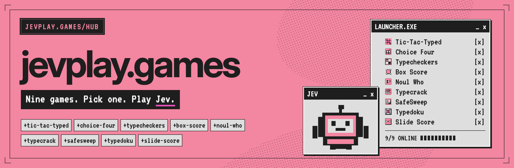
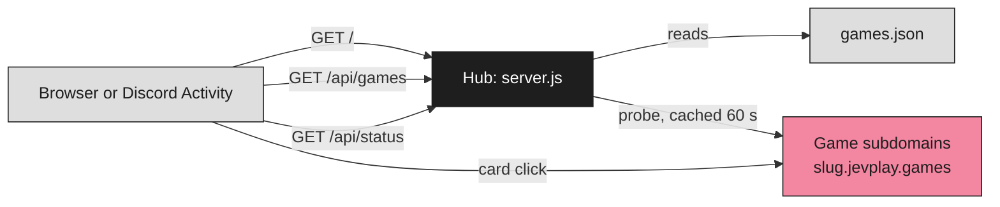

<p align="center"></p>

<h1 align="center">jevplay.games</h1>

<p align="center"><b>Nine games. Pick one. Play Jev.</b></p>

<p align="center">
  
  
  
  
</p>

<p align="center">
  <a href="https://jevplay.games">Live hub</a> · <a href="#quick-start">Quick start</a> · <a href="#how-it-works">How it works</a> · <a href="#config">Config</a> · <a href="#godaddy-nodejs-hosting">Hosting</a> · <a href="DISCORD.md">Discord</a> · <a href="deploy/REDIRECTS.md">Rename cutover</a>
</p>

The front door at `jevplay.games`. It is a launcher: each card links to that game's own subdomain
(`noul-who.jevplay.games`, `typedoku.jevplay.games`, …). Every game stays a separate app with its own Discord
application, secrets and origin checks, so nothing in the games changes. The games: Tic-Tac-Typed, Choice Four,
Typecheckers, Box Score, Noul Who, Typecrack, SafeSweep, Typedoku and Slide Score.

> [!NOTE]
> All nine games run as Discord Activities, but only Tic-Tac-Typed has been verified launching inside Discord
> (`DISCORD.md`). The other eight use the same pattern and have not been launched there yet. During the rename,
> cards link to each game's pre-rename subdomain until that game cuts over (`deploy/REDIRECTS.md`).

## Quick start

Requires Node 18 or newer (`engines` in `package.json`). Zero runtime dependencies, native Node `http`.

```sh
npm test        # node --test
npm run build   # validates games.json and the shipped assets, prints each game's URL
npm start       # listens on process.env.PORT (default 3000), 0.0.0.0
```

Open `http://localhost:3000`.

## How it works



- `games.json` is the one source of names, slugs, taglines and card art, for the launcher and the art scripts.
- `/api/games` returns the catalog with each game's resolved URL. `/api/status` probes each game's origin
  server-side (cached 60 s); any response under 500, including a 403 `origin_rejected`, counts as online.
- `public/brand/brand.css` is the shared pink/ink stylesheet, with Inter and VT323 self-hosted (SIL OFL 1.1,
  `public/brand/OFL.txt`, `public/brand/OFL-VT323.txt`). This repo owns it: change it here, then copy it to the nine
  games byte for byte and check the hash (`deploy/BRAND-RESYNC.md`).

## Config

Add or rename games in `games.json`. URLs come from `HUB_BASE_DOMAIN` (default `jevplay.games`) or per-game
`GAME_URL_<SLUG>` overrides; see `.env.example`.

While a row carries `legacySlug`, its card points at `https://<legacySlug>.<HUB_BASE_DOMAIN>`: the game's new
subdomain is not live yet, so the card goes where the game answers today. Override per game with
`GAME_URL_<NEW_SLUG>`, for example `GAME_URL_NOUL_WHO=https://noul-who.jevplay.games` to flip one game early. An
override set under the pre-rename key is still honoured while the row has `legacySlug`. When a game's new subdomain
is live, delete `legacySlug` from its row. The full runbook, including the Cloudflare 301s, is
[`deploy/REDIRECTS.md`](deploy/REDIRECTS.md).

## GoDaddy Node.js hosting

Follows the [upload guide](https://www.godaddy.com/help/upload-my-ai-generated-app-to-godaddy-nodejs-hosting-42987):
root `package.json` with `build` and `start`, port from `PORT`, no `node_modules` in the zip
(`package.json` has no zip script, so build the zip by hand), well under 100 MB, one app per upload.

1. `npm test && npm run build`
2. Zip the folder contents (not the folder, no `node_modules`, no `.env`, no `art/`).
3. GoDaddy Node.js Hosting → Upload ZIP → Deploy → check Runtime Logs on the preview URL.
4. Set `HUB_BASE_DOMAIN` (and any `GAME_URL_*`) in Settings, then Publish Now.

The games are deployed separately and each is attached to its own subdomain. The hub never proxies them.

## Repository layout

| Path | What it is |
| --- | --- |
| `server.js` | The hub: static files, `/api/games`, `/api/status`, `/api/activity/config`, `/healthz` |
| `lib/catalog.js` | Loads and validates `games.json`, resolves each game's URL |
| `games.json` | The nine games: slug, legacy slug, name, tagline, tags, Discord app ID, card art |
| `public/` | Landing page, terms, privacy, `hub.css`, `hub.js` |
| `public/brand/` | Shared `brand.css`, fonts and their licences, icons, card art, hosted social cards |
| `art/` | Art pipeline (emblems, Discord art, icons); not shipped |
| `deploy/` | Rename cutover runbook, brand.css re-sync procedure (`BRAND-RESYNC.md`), Train compose for SafeSweep and Typedoku |
| `tests/` | `node --test` suite |

## Contributing

Run `npm test` and `npm run build` before opening a pull request. Keep `brand.css` byte-identical across the ten
repos: change it here, copy it out, compare hashes. Write the opponent as **Jev** and the brand as **jevplay.games**.

<p align="center"><sub>A jevplay.games project · Steward: CompleteTech LLC · MIT licensed<br>Not an official TypeSafe AI publication; the pink, ink and pixel-window styling is a nod to typesafe.ai. Jev, System One and TypeSafe are their respective owners' names.</sub></p>
